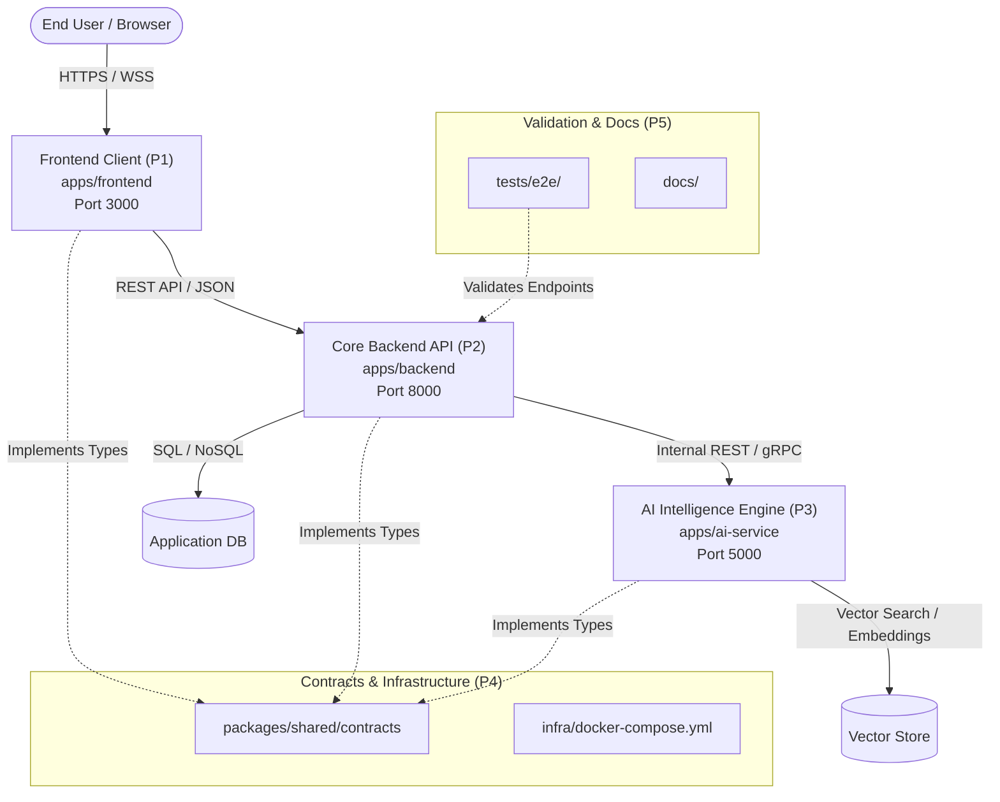

# System Architecture & Technical Blueprint

This document specifies the system design, communication protocols, and runtime architecture for the project.

---

## 1. High-Level System Topology



---

## 2. Port & Network Allocation

To prevent port collisions across local development and multi-container environments:

| Service | Port | Host Address | Responsibility | Owner |
| :--- | :--- | :--- | :--- | :--- |
| **Frontend Web** | `3000` | `http://localhost:3000` | Web UI & SPA Dashboard | `P1` |
| **Backend API** | `8000` | `http://localhost:8000` | Core Business API & Auth | `P2` |
| **AI Engine** | `5050` | `http://localhost:5050` | LLM Agents & Inference (Port 5050 used to avoid macOS AirPlay collision) | `P3` |
| **Primary Database** | `5432` | `localhost:5432` | PostgreSQL (or SQLite local) | `P2` / `P4` |
| **Vector DB / Cache**| `6379` | `localhost:6379` | Redis / Chroma / Qdrant | `P3` / `P4` |

---

## 3. Communication Patterns

### A. Client to Backend (`P1` <-> `P2`)
- **Protocol:** REST over HTTPS + WebSocket for real-time streaming notifications.
- **Authentication:** Bearer JWT in the `Authorization` header.
- **Contract Source:** `packages/shared/contracts/api.ts`.
- **Response Format:**
  ```json
  {
    "success": true,
    "data": {},
    "error": null,
    "meta": { "timestamp": "2026-10-22T06:00:00Z", "requestId": "req_123" }
  }
  ```

### B. Backend to AI Engine (`P2` <-> `P3`)
- **Protocol:** Internal HTTP/JSON RPC.
- **Security:** Internal network isolation / shared service token (`X-Internal-Token`).
- **Contract Source:** `packages/shared/contracts/ai.ts`.
- **Pattern:** Asynchronous job execution or streaming response for LLM token emission.

---

## 4. Monorepo Structure & Module Boundaries

- `apps/frontend/`: Client UI logic only. Consumes `@workspace/shared` for contract types.
- `apps/backend/`: Server logic, routing, database access. Consumes `@workspace/shared`.
- `apps/ai-service/`: LLM chains, prompt templates, agentic tools. Consumes `@workspace/shared`.
- `packages/shared/`: Shared TypeScript models, validation schemas (Zod/JSON Schema), error constants.
- `infra/`: Docker compose, Kubernetes manifests, CI configuration files.
- `docs/`: All documentation, task boards, playbooks, and contracts.
- `tests/`: Integration tests that exercise contracts between the services.
