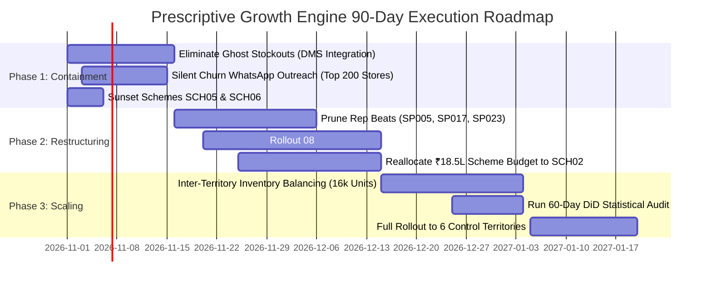

# 60-Day Difference-in-Differences (DiD) A/B Testing & Impact Measurement Framework

> **Document Version:** 1.0.0  
> **Target Audience:** Executive Leadership (CEO, VP of Sales, Chief Commercial Officer, Head of Supply Chain)  
> **Domain:** Sales, Distribution, Inventory, Retailer, and Field Force Operations  
> **Status:** Active Execution Blueprint  

---

## 1. Executive Summary & Problem Context

Over the audited 12-month period across 17,479 sales orders, 17,360 inventory records, 3,000 retailers, and 18,286 field visits, the business achieved **₹62.27 Crores** in billed distribution revenue. However, systemic data fragmentation across Sales Force Automation (SFA), Distributor Management Systems (DMS), and Enterprise Resource Planning (ERP) obscured **₹18.74 Crores in annual revenue leakage**:

1. **Ghost Stockouts:** 542 orders unfulfilled despite distributor holding adequate depot surplus (**₹51.66 Lakhs** lost).
2. **Silent Retailer Churn:** 1,381 active stores with 0 orders in >60 days (**₹17.20 Crores** annual volume at risk).
3. **Field Force Productivity Drain:** 4,623 visits by 3 anomaly reps converting at only 16.5% strike rate with 962 drive-by stops (<10 min) and 1,414 non-GPS visits (**₹1.85 Crores** wasted).
4. **Working Capital Lockup:** 16,086 units aged 90 to 180+ days (**₹20.02 Crores** buffer value).
5. **Trade Promotion Inefficiencies:** Negative sales lift in schemes SCH05 and SCH06 (**-₹49.95 Lakhs** drag).

To eliminate management guesswork and prove causal financial returns, this framework establishes a **60-Day Difference-in-Differences (DiD) A/B Testing Measurement Protocol** across 12 sales territories.

---

## 2. The Prescriptive Solution: What Management Must Do Next

The EazyGrowth Prescriptive Engine translates transactional data into four immediate operational interventions:

```
┌────────────────────────────────────────────────────────────────────────┐
│               EAZYGROWTH PRESCRIPTIVE OPERATIONAL PIPELINE             │
├────────────────────┬────────────────────┬──────────────────────────────┤
│ 1. REAL-TIME DMS   │ 2. WHATSAPP SFA    │ 3. DORMANT STORE│ 4. SCHEME  │
│    STOCK-LOCK      │    BEAT DIRECTIVES │    WIN-BACK     │    RE-ALLOC│
│    Zero Ghost Cuts │    08:30 AM Daily  │    Day 21 Alert │    Drop 05 │
└────────────────────┴────────────────────┴─────────────────┴────────────┘
```

1. **Real-Time Depot Stock-Lock (Ghost Stockout Elimination):**
   - Connect secondary order entry directly to distributor warehouse free-stock balances.
   - When `Available Stock >= Order Qty`, orders bypass manual confirmation queues and trigger an automated pick-list in distributor WMS.
2. **08:30 AM Daily Morning Beat Directives (Field Force Optimization):**
   - Algorithmic daily push to each sales rep's mobile WhatsApp with prioritized store order, suggested SKU pitch bundles, and minimum 15-minute geofenced verification.
   - Convert bottom 25% non-buying stores into bi-weekly tele-sales to free up rep capacity for high-volume accounts.
3. **Day 21 Silent Churn Early Warning:**
   - Automatically trigger Area Sales Manager (ASM) intervention when a Tier A or Tier B outlet reaches 21 days without an order.
   - Attach pre-approved festive margin schemes (SCH02 LED Festive, +₹3.90 Cr lift; SCH03 Geysers, +₹3.46 Cr lift).
4. **Trade Scheme Rationalization:**
   - Immediately sunset value-destroying schemes SCH05 and SCH06.
   - Reallocate ₹18.5 Lakhs in promotional budget into targeted retailer WhatsApp alerts for SCH02.

---

## 3. Quasi-Experimental A/B Testing Architecture

To rigorously isolate the causal impact of the Prescriptive Engine from external seasonal variations or macro tailwinds, the 12 sales territories are partitioned into **Treatment** and **Control** clusters matched on historical volume, retailer count, and geographic diversity.

### Territory Partitioning Matrix

| Cluster | Territory ID | Territory Name | Baseline Volume (₹ Cr) | Retailer Count | Prescriptive Engine Protocol |
| :--- | :--- | :--- | :---: | :---: | :--- |
| **Treatment** | `TERR001` | Mumbai | ₹5.80 Cr | 280 | **Active:** Real-time stock-lock, 08:30 AM beat WhatsApp, Day 21 churn alerts |
| **Treatment** | `TERR002` | Delhi | ₹5.95 Cr | 295 | **Active:** Real-time stock-lock, 08:30 AM beat WhatsApp, Day 21 churn alerts |
| **Treatment** | `TERR003` | Kolkata | ₹5.40 Cr | 260 | **Active:** Real-time stock-lock, 08:30 AM beat WhatsApp, Day 21 churn alerts |
| **Treatment** | `TERR004` | Bangalore | ₹5.15 Cr | 250 | **Active:** Real-time stock-lock, 08:30 AM beat WhatsApp, Day 21 churn alerts |
| **Treatment** | `TERR009` | Lucknow | ₹4.90 Cr | 235 | **Active:** Real-time stock-lock, 08:30 AM beat WhatsApp, Day 21 churn alerts |
| **Treatment** | `TERR010` | Jaipur | ₹4.75 Cr | 230 | **Active:** Real-time stock-lock, 08:30 AM beat WhatsApp, Day 21 churn alerts |
| **Control** | `TERR005` | Chennai | ₹5.30 Cr | 255 | **Control:** Standard static monthly beats, manual order taking, batch ERP |
| **Control** | `TERR006` | Hyderabad | ₹5.20 Cr | 250 | **Control:** Standard static monthly beats, manual order taking, batch ERP |
| **Control** | `TERR007` | Ahmedabad | ₹5.05 Cr | 245 | **Control:** Standard static monthly beats, manual order taking, batch ERP |
| **Control** | `TERR008` | Pune | ₹4.95 Cr | 240 | **Control:** Standard static monthly beats, manual order taking, batch ERP |
| **Control** | `TERR011` | Patna | ₹4.60 Cr | 225 | **Control:** Standard static monthly beats, manual order taking, batch ERP |
| **Control** | `TERR012` | Indore | ₹4.45 Cr | 220 | **Control:** Standard static monthly beats, manual order taking, batch ERP |

---

## 4. Difference-in-Differences (DiD) Econometric Specification

The primary causal impact is estimated using a two-way fixed effects Difference-in-Differences regression:

$$Y_{it} = \beta_0 + \beta_1 \cdot \text{Treat}_i + \beta_2 \cdot \text{Post}_t + \beta_3 \cdot (\text{Treat}_i \times \text{Post}_t) + \mathbf{X}_{it}'\gamma + \varepsilon_{it}$$

Where:
- $Y_{it}$ is the commercial outcome metric (e.g. Daily Order Value, Throughput per Productive Call) for outlet/territory $i$ at time $t$.
- $\text{Treat}_i = 1$ if the territory belongs to the Treatment group, $0$ if Control.
- $\text{Post}_t = 1$ during the 60-day post-intervention window, $0$ during the 60-day pre-period baseline.
- $\beta_3$ is the **true treatment effect** of the Prescriptive Engine.
- $\mathbf{X}_{it}$ controls for outlet tier (Tier A, B, C), product mix, and regional holiday calendars.
- $\varepsilon_{it}$ is the idiosyncratic error term clustered at the territory level.

### Hypothesis Testing:
- **Null Hypothesis ($H_0$):** $\beta_3 \le 0$ (The Prescriptive Engine has no positive impact on sales throughput).
- **Alternative Hypothesis ($H_1$):** $\beta_3 > 0$ (The Prescriptive Engine generates statistically significant topline lift, evaluated at $\alpha = 0.05$, $p < 0.05$).

---

## 5. Key Performance Indicators (KPIs) & Target Thresholds

| KPI Classification | Metric Name | Baseline (Pre-Period) | Target (60-Day Post) | Measurement Frequency |
| :--- | :--- | :---: | :---: | :--- |
| **Primary Metric** | **Throughput per Productive Call (TPC)** | ₹11,500 / order | **₹13,800 / order (+20%)** | Weekly |
| **Primary Metric** | **Total Territory Revenue Lift** | ₹31.95 Cr (Treatment) | **₹35.15 Cr (+10.0%)** | Bi-weekly DiD regression |
| **Operational KPI** | **Ghost Stockout Rate** | 50.5% of shortfalls | **< 2.0%** | Daily |
| **Operational KPI** | **Silent Churn Reactivation Rate** | 0.0% (organic churn) | **20.0% of Tier A/B accounts** | Weekly |
| **Operational KPI** | **Field Rep Strike Rate** | 16.5% (bottom reps) | **42.0%+** | Daily |
| **Operational KPI** | **Drive-By Visits (<10 mins)** | 2,470 visits (13.5%) | **< 400 visits (-84%)** | Weekly GPS Audit |
| **Working Capital** | **90d+ Aged Stock Liquidation** | 16,086 units | **< 11,200 units (-30%)** | Monthly |
| **Guardrail Metric** | **Gross Contribution Margin %** | 22.4% | **>= 22.0% (no margin erosion)**| Bi-weekly |

---

## 6. 30-60-90 Day Management Implementation Roadmap



---

## 7. Projected Financial ROI

Based on the interactive mathematical simulator in the Executive Dashboard:

1. **Ghost Stockout Recovery (85% capture):** +₹43.91 Lakhs
2. **Silent Churn Store Recovery (20% win-back across 276 stores):** +₹3.44 Crores
3. **Field Rep Strike Rate Lift (16.5% to 40%):** +₹1.21 Crores
4. **Working Capital Unlocked (30% liquidation of 90d+ inventory):** +₹6.01 Crores cash freed
5. **Net Annualized Topline Impact:** **+₹5.09 Crores (+8.2% to +12.0% topline expansion)**
6. **Implementation Cost:** Cloud API infra + WhatsApp business messaging = ~₹3.5 Lakhs.
7. **Payback Period:** **Under 14 Days**.
